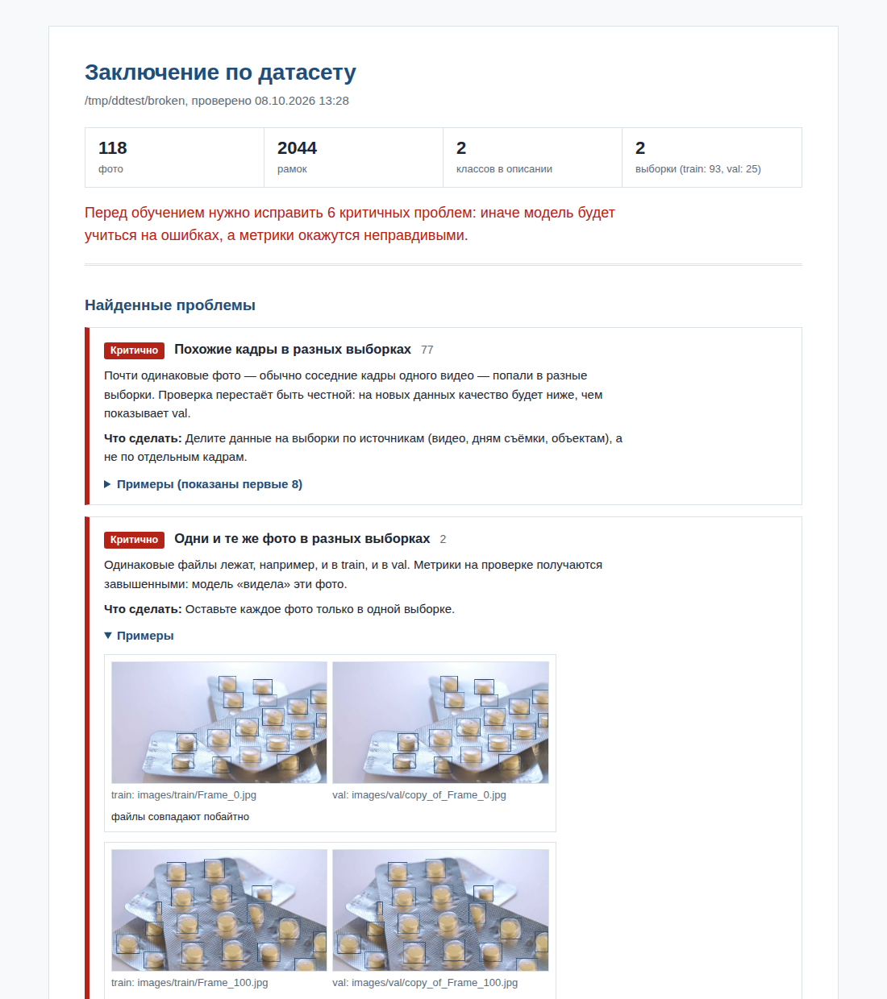

# dataset-doctor

Проверка датасета для детекции в формате YOLO перед обучением. Одна команда — и вы получаете HTML-заключение: какие ошибки в разметке, есть ли дубли и, главное, не утекли ли кадры из обучения в проверку.



## Зачем

Модель учится на том, что ей дали, включая ошибки. А метрика на val честна ровно настолько, насколько val не похож на train. Обе проблемы легко пропустить глазами, особенно когда фото тысячи.

Например, в открытом датасете Ultralytics medical-pills инструмент нашёл 73 пары почти одинаковых кадров в train и val: это кадры одного видео, разложенные по разным выборкам. Поэтому mAP50 около 0,99 на этом датасете заметно завышен, на по-настоящему новых фото качество будет ниже.

## Что проверяется

Критичные проблемы:
- битые и нечитаемые фото;
- строки разметки, которые нельзя прочитать как рамку YOLO;
- номер класса больше, чем классов в `data.yaml`;
- рамки с центром вне фото, нулевым или отрицательным размером;
- одинаковые фото в разных выборках;
- почти одинаковые кадры в разных выборках (перцептивный хэш).

Замечания:
- поворот, записанный только в EXIF: в разных программах рамки могут съехать;
- фото без файла разметки и файлы разметки без фото;
- рамки, выходящие за край фото, и рамки меньше 4 пикселей;
- двойные рамки на одном объекте и один объект с двумя классами;
- дубли внутри выборки, сильный дисбаланс классов, класс только в одной выборке;
- доля фото без объектов.

## Установка и запуск

```
pip install git+https://github.com/8MVR3/dataset-doctor.git
dataset-doctor путь/к/data.yaml --out report.html
```

Без установки, из папки проекта:

```
pip install Pillow PyYAML
python -m dataset_doctor путь/к/data.yaml
```

Понимает `data.yaml` от Ultralytics и Roboflow, а также папки вида `images/train` + `labels/train` и `train/images` + `train/labels`. Разметку сегментации (полигоны) проверяет по описывающим прямоугольникам.

Параметры:
- `--out report.html` — куда сохранить отчёт;
- `--json findings.json` — дополнительно выгрузить находки в JSON;
- `--near 6` — порог похожести кадров: меньше — строже, больше — найдёт больше пар;
- `--fail-on-critical` — вернуть код 1 при критичных проблемах, удобно в CI.

## Проверка в CI

```
- run: pip install git+https://github.com/8MVR3/dataset-doctor.git
- run: dataset-doctor data/data.yaml --out report.html --fail-on-critical
```

## Тесты

```
pip install pytest
pytest
```

## Лицензия

MIT
